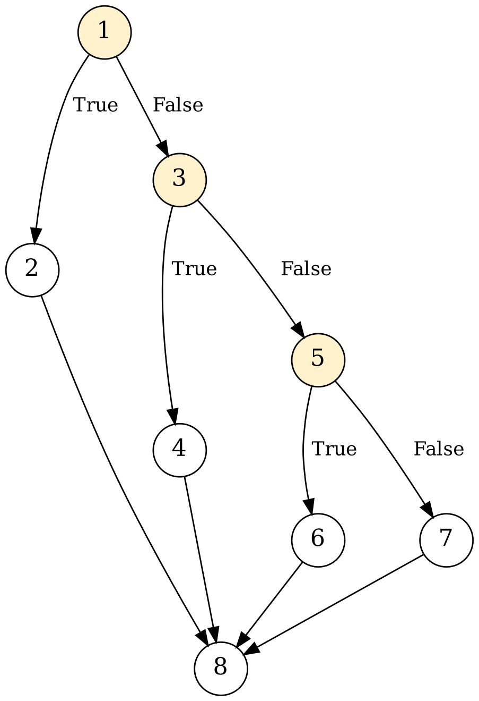

# Lab 04 - White-Box Testing

**Course:** Software Quality Engineering | **Program:** Software Engineering, Fall 2026
**Name:** ______________________ **Roll No:** ______________________
**Method tested:** `ResultChecker.getResult(int marks, int attendance)`

---

## Requirement

- Attendance below 75% gives **"Not eligible"**.
- Otherwise, marks of 80 or more give **"Distinction"**, 50 to 79 give **"Pass"**, and below 50 give **"Fail"**.

## Step 1: Numbering the code into nodes

```java
public static String getResult(int marks, int attendance) {
    String result;                         // node 1
    if (attendance < 75) {                 // node 1 (decision)
        result = "Not eligible";           // node 2
    } else if (marks >= 80) {              // node 3 (decision)
        result = "Distinction";            // node 4
    } else if (marks >= 50) {              // node 5 (decision)
        result = "Pass";                   // node 6
    } else {
        result = "Fail";                   // node 7
    }
    return result;                         // node 8
}
```

| Node | Statements in the node | Type |
|------|------------------------|------|
| 1 | `String result; if (attendance < 75)` | Decision |
| 2 | `result = "Not eligible"` | Normal |
| 3 | `else if (marks >= 80)` | Decision |
| 4 | `result = "Distinction"` | Normal |
| 5 | `else if (marks >= 50)` | Decision |
| 6 | `result = "Pass"` | Normal |
| 7 | `result = "Fail"` | Normal |
| 8 | `return result` | Normal |

Every `if` / `else if` has its own node because each one is a separate decision. The four branches (2, 4, 6, 7) all join again at node 8.

## Step 2: Control Flow Graph



*Figure 1: CFG of getResult. Yellow circles are the decision nodes (1, 3 and 5).*
The editable version is in `cfg-ex5-resultchecker.drawio` (open it in https://app.diagrams.net).

Edges: 1→2 (True), 1→3 (False), 3→4 (True), 3→5 (False), 5→6 (True), 5→7 (False), 2→8, 4→8, 6→8, 7→8.

## Step 3: Cyclomatic complexity V(G)

- Using edges and nodes: E = 10, N = 8, so V(G) = 10 - 8 + 2 = **4**
- Using decision nodes: P = 3 (nodes 1, 3, 5), so V(G) = 3 + 1 = **4**

Both answers match, so the CFG is correct. V(G) = 4 is in the 1 to 10 range, which means the method is simple and low risk. We need at least **4 test cases**.

## Step 4: Independent paths

| Path | Nodes | When it happens |
|------|-------|-----------------|
| P1 | 1-2-8 | Attendance is below 75 |
| P2 | 1-3-4-8 | Attendance is 75 or more, marks are 80 or more |
| P3 | 1-3-5-6-8 | Attendance is 75 or more, marks are 50 to 79 |
| P4 | 1-3-5-7-8 | Attendance is 75 or more, marks are below 50 |

There are 4 paths, which is the same as V(G).

## Step 5: Test cases

The expected results were written from the requirement, before running the program.

| ID | marks | attendance | Expected Result | Path followed |
|----|-------|------------|-----------------|---------------|
| TC-01 | 85 | 60 | Not eligible | 1-2-8 |
| TC-02 | 90 | 85 | Distinction | 1-3-4-8 |
| TC-03 | 65 | 80 | Pass | 1-3-5-6-8 |
| TC-04 | 30 | 90 | Fail | 1-3-5-7-8 |

TC-01 uses high marks (85) on purpose. It shows that low attendance wins even when the marks would have given a Distinction.

## Step 6: Running the tests manually

```
> java ResultChecker.java 85 60
Final result: Not eligible
> java ResultChecker.java 90 85
Final result: Distinction
> java ResultChecker.java 65 80
Final result: Pass
> java ResultChecker.java 30 90
Final result: Fail
```

| ID | Expected Result | Actual Result | Status |
|----|-----------------|---------------|--------|
| TC-01 | Not eligible | Not eligible | Pass |
| TC-02 | Distinction | Distinction | Pass |
| TC-03 | Pass | Pass | Pass |
| TC-04 | Fail | Fail | Pass |

All four tests passed and no defect was found.

## Step 7: Coverage

Total: 8 nodes, 10 edges, 4 independent paths.

**Which nodes, edges and paths each test executes (X = executed):**

| Item | TC-01 | TC-02 | TC-03 | TC-04 |
|------|:-----:|:-----:|:-----:|:-----:|
| Node 1 | X | X | X | X |
| Node 2 | X | | | |
| Node 3 | | X | X | X |
| Node 4 | | X | | |
| Node 5 | | | X | X |
| Node 6 | | | X | |
| Node 7 | | | | X |
| Node 8 | X | X | X | X |
| Edge 1→2 | X | | | |
| Edge 1→3 | | X | X | X |
| Edge 3→4 | | X | | |
| Edge 3→5 | | | X | X |
| Edge 5→6 | | | X | |
| Edge 5→7 | | | | X |
| Edge 2→8 | X | | | |
| Edge 4→8 | | X | | |
| Edge 6→8 | | | X | |
| Edge 7→8 | | | | X |
| Path P1 | X | | | |
| Path P2 | | X | | |
| Path P3 | | | X | |
| Path P4 | | | | X |

**Coverage as the tests are added:**

| Tests run | Statement coverage | Branch coverage | Independent paths covered |
|-----------|-------------------:|----------------:|---------------------------|
| up to TC-01 | 37.5% (3/8) | 20.0% (2/10) | 1 of 4 |
| up to TC-02 | 62.5% (5/8) | 50.0% (5/10) | 2 of 4 |
| up to TC-03 | 87.5% (7/8) | 80.0% (8/10) | 3 of 4 |
| up to TC-04 | 100.0% (8/8) | 100.0% (10/10) | 4 of 4 |

### Which tests are needed for 100% coverage?

- **100% statement coverage:** all four tests (TC-01 to TC-04). Each of nodes 2, 4, 6 and 7 is reached by only one test, so none of the four can be dropped.
- **100% branch coverage:** also all four tests. Edges 1→2, 3→4, 5→6 and 5→7 are each used by only one test.

In Example 1 (`TuitionFee`), statement coverage was reached with one test but branch coverage needed two. That happened because the `if` had no `else`, so there was a False edge going straight to the next node with no statement of its own. Here, every `if` / `else if` branch has an assignment statement in it, so the two coverage levels need the same number of tests. The V(G) = 4 told us this in advance.

## Extra practice: boundary tests (links to Lab 3)

These follow paths that are already covered, so the coverage numbers do not change. They check the edges of each range.

| ID | marks | attendance | Expected | Actual | Status |
|----|-------|------------|----------|--------|--------|
| BT-01 | 80 | 75 | Distinction | Distinction | Pass |
| BT-02 | 79 | 75 | Pass | Pass | Pass |
| BT-03 | 50 | 75 | Pass | Pass | Pass |
| BT-04 | 49 | 75 | Fail | Fail | Pass |
| BT-05 | 90 | 74 | Not eligible | Not eligible | Pass |
| BT-06 | 90 | 75 | Distinction | Distinction | Pass |

## Conclusion

The method `getResult` has V(G) = 4, so four test cases were enough to follow every independent path. They gave 100% statement, branch and path coverage, and all of them passed. Coverage of 100% does not prove the code has no bugs. It only shows that every part was executed, so the black-box boundary tests were run as well.

## Files in this folder

| File | What it is |
|------|------------|
| `ResultChecker.java` | The program that was tested |
| `cfg-ex5-resultchecker.drawio` | Editable CFG (draw.io) |
| `cfg-ex5-resultchecker.png` | CFG picture for the report |
| `lab04-coverage-table.xlsx` | Test cases, X-mark matrices, V(G) and coverage formulas |
| `test-results.txt` | Command-line output of all 10 test runs |
| `screenshots/` | Your own screenshots go here (see below) |
